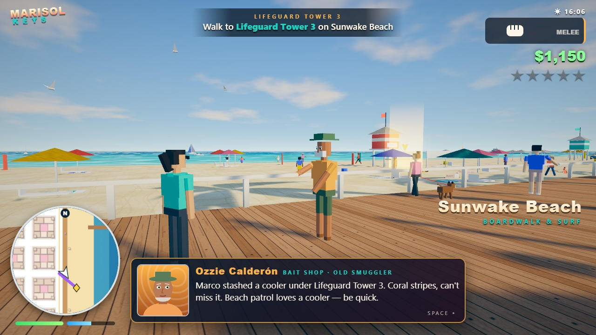

[](https://make.fun/c/gta6-01)
[](https://make.fun/c/gta6-01)
[](https://make.fun/c/gta6-01)

# Marisol Keys

*A sun-bleached open-world crime story that runs in your browser.*

Six years after she left on the last ferry, ex-ferry pilot **Tessa Vane** comes home to
**Marisol Keys** — a pastel island city of art-deco boulevards, glass towers, canals and a
container harbor, tied to the mainland by two long causeways. Her late brother left her a
waterproof ledger, *the Tide Book*, listing every payoff in the harbor. A crane-yard boss wants it.
A police captain wants it at the bottom of the bay. Tessa wants the whole island to read it.

Everything — the city, cars, people, signage, portraits, music and sound — is generated by the
game's own code in the browser. No asset files, no network requests.


| | |
|---|---|
|  |  |
|  | |

## Run it

```
node serve.ts          # serves game/ on http://localhost:8080
```

Open the page in desktop Chrome, click **New Game**, then click the view to capture the mouse.
Any static file server works too: the game is just the files under `game/`.

## Controls

| Key | On foot | In a vehicle |
|---|---|---|
| W A S D | walk | throttle, brake / reverse, steer |
| Shift | sprint | — |
| X | crouch in cover (half damage) | — |
| Space | jump | handbrake (drift) |
| Mouse | look / aim | look around |
| Left click / Right click | fire / aim | drive-by (hold right, click left) |
| F | steal / enter a car | get out |
| 1-5, wheel | fists, Marlin .38, Wasp SMG, Breaker 12, Seagrape Slugger bat | — |
| R | reload | — |
| E | talk, buy, start a job | start a job (taxi, cruiser), garage |
| Q | buy armour or a car | next radio station |
| H | — | horn |
| C | — | look behind |
| V | camera distance | camera distance, hood cam |
| G | — | siren (in an MKPD cruiser or an ambulance) |
| T | — | hail a Keys Cab to your map waypoint (fast travel, paid) |
| M or Tab | phone: map, story, jobs, assets | same |
| Esc or P | pause menu (save, settings, controls) | same |

## What's in it

**The island.** 16 x 16 blocks in nine districts — Glasswater's glass towers, the Pastel Mile
art-deco strip, Sunwake Beach with its boardwalk, lifeguard towers and pier, Lantern Canals with
footbridges and skiffs, Saltgate Harbor's gantry cranes and container stacks, the villas of
Mirador Hills, Palmetto Flats, Old Keys and Seagrape Park — and two causeways to the mainland.
A stone seawall with promenade railings, quay bollards and riprap rings the island; across the
channel the causeways land at Port Calloway on the mainland, a coastal town under scrub hills,
and the car ferry MV Calloway Belle shuttles between it and Saltgate Harbor.
Landmarks: the 206 m Lumen Tower, rounded deco corner towers in neon, Ozzie's Bait & Tackle,
The Coral Room, the pier café, and a skyline of invented brands (Mango Bay Cola, Palmetto Bank,
Vela Cinema, Hotel Esmeralda...).

**A living city.** Lane-following traffic that obeys working traffic lights; pedestrians who walk
the sidewalks, cross at the zebras on their light, jog, walk their dogs and their kids, talk on their phones,
sunbathe, wade in the surf, play beach volleyball, flee from gunfire (or stop to film it on their
phones) and get thrown by speeding cars; boats on the water; random street events (police pursuits, Gull's crew loitering at harbor hangouts
and Las Linternas on the canal corners,
street racers, muggings you can break up). When someone goes down near you, a Sunwake Medical
ambulance runs lights and siren to the scene and two paramedics kneel over the patient and carry
them off; a burning wreck brings KFD Engine 7, whose crew hoses it down before rolling home.

**Driving.** Thirteen invented vehicles — Solara Vela sedan, Kestrel Strata GT, Marisol Spyder
convertible, Sandpiper beach buggy (parked on the sand), Mako Tradesman pickup, Keys Cab, Coastline Transit bus, MKPD Interceptor, Sunrise
Courier van, Sunwake Medical Rescue ambulance, KFD Engine 7 fire truck, Zephyr 400 motorbike,
Riptide 22 speedboat — with arcade physics, handbrake drifts,
stunt-jump ramps, crashes, smoke, fire and explosions, skid marks, and a speed-sensitive chase
camera. Near misses at speed and long clean drifts pay street-style cash.

**Wanted level.** One to five stars from crimes the city sees. MKPD cruisers route through the
streets and ram, officers try to arrest you at low levels and shoot at high ones, roadblocks with
spike strips from three stars, the Air One helicopter from four, dispatch radio narrating the
chase. Break line of sight and leave the search circle to escape — or respray the car, or grab a
bribe star.

**Combat.** Fists, the Seagrape Slugger bat, Marlin .38, Wasp SMG and Breaker 12 with muzzle flash, tracers, sparks and
hit markers; crouch in cover; gang crews and officers that advance, strafe, stagger and drop ammo.

**Story.** *The Tide Book*: ten missions with dialogue and painted portraits for Tessa, Ozzie
Calderón, Priya Lund, Lulu Marchetti, Gideon "Gull" Moreau and Captain Rourke Hale — a homecoming
drive, a beach stash, a street race, wiretap relays against the clock, a harbor shoot-out, a
stolen evidence van, a speedboat run round the island, a downtown takedown, an estate raid and a
four-star run across the causeway, then the credits. Contacts wait in person; face-to-face scenes
cut to a two-shot camera; a new game opens with a letterboxed glide down from the skyline; a
failed mission can be retried on the spot, and any finished one replayed from the phone. Wander too
long and the next contact phones you with a nudge.

**Progression.** Money from missions and jobs: Keys Cab fares, Sunrise Couriers deliveries, the
Night Sprint time trial, the Riptide Run speedboat time trial through buoy gates off the beach,
Vigilante runs in a stolen cruiser, Paramedic runs in the ambulance outside Sunwake Medical,
stunt jumps. Spend it at Keys Tactical
(guns, ammo, armour), Pastel Paint & Body (resprays), Sunbelt Garage (repairs and three tiers of
engine, tyre and armour tuning), Sunwake Threads (five outfits), Kestrel Motors (cars delivered to
your garage) and on four properties that pay out every day. Twenty hidden Tide Book pages, pickups,
and a safehouse that saves, sleeps to morning and keeps your car. The phone tracks an island
completion percentage with a checklist; each quarter is announced and 100% pays a $100,000 bonus.
It also keeps your records: top speed, longest stunt jump, longest drift.

**Interface.** A rotating minimap drawn from the city plan with building footprints, GPS route,
search circle and blips; health, armour, money, stars, weapon and ammo, objective and timer,
speedometer, district pop-ups, first-time tips; a phone with the illustrated island map (click to
drop a waypoint), story progress, jobs and assets; title screen over a live flyover with music;
pause, settings and controls; save and continue.

**Look and sound.** A golden-hour sky with clouds, sky-lit reflections, soft shadows, bloom and a
warm colour grade, an animated sea with sun glints and surf, a day/night cycle with lit windows,
glowing signs, street lamps and headlights, siren light spilling over the street, tropical
storms with rain, wet streets and lightning, and a rainbow as they clear; stars and a moon at
night. WebAudio engines, tyre squeal, sirens, gunshots, surf,
gulls, rain and three radio stations (Tidal 101.3, Static 88 FM, Reef Room Radio) composing their
own music, with DJs cutting in between tracks; MKPD, ambulance and fire engine each have their own
siren.

## Source layout

`game/src/` is split by job: `world/` (city plan, terrain, collision), `roads/`, `buildings/`,
`vegetation/`, `props/`, `water/`, `sky/`, `weather/`, `vehicles/`, `traffic/`, `peds/`,
`player/`, `camera/`, `combat/`, `fx/`, `police/`, `emergency/`, `missions/`, `story/`, `activities/`,
`economy/`, `progress/`, `ui/`, `audio/`, `save/`, `core/` and `shots/`. three.js is the only library
(`game/vendor/three.module.min.js`).

## Testing

`bash tools/regression/run.sh` (with the local server running) plays the real game in headless
Chrome: it drives all ten story missions to the end, replays one from the phone, holds a
five-star police siege through several deaths and respawns, saves and continues, follows an
ambulance call and a fire call from dispatch to departure, checks that nothing leaks between
sessions (phone and controls, a stolen cruiser, ammo across saves, saving at sea), and runs the
title flyover and a short drive through the real frame loop — each script prints its result and
any page exceptions.

## Screenshots

`index.html?shot=<sunset|boardwalk|quay|map>&seed=1` builds a scripted scene with the real game
code and renders one stable frame (`shots.json` lists them). `tools/capture-shots.sh` takes them
with headless Chrome over the DevTools protocol, with `node serve.ts --port 8137` running.

## Hand-in

`main.ts` copies `game/` and `screenshots/` to the output folder and writes `dossier.json`:

```
mkdir -p out && MAKEFUN_OUTPUT_DIR=out node main.ts
```

MIT licensed. All names, places, characters and brands in the game are invented.
