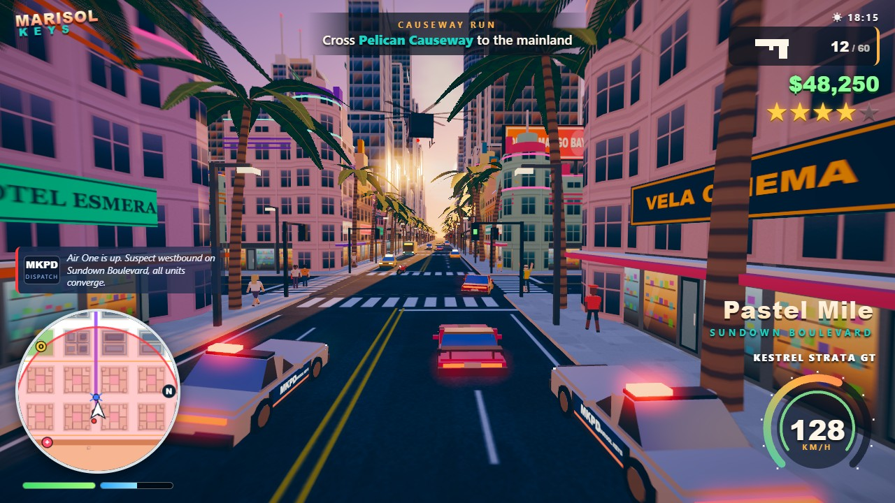
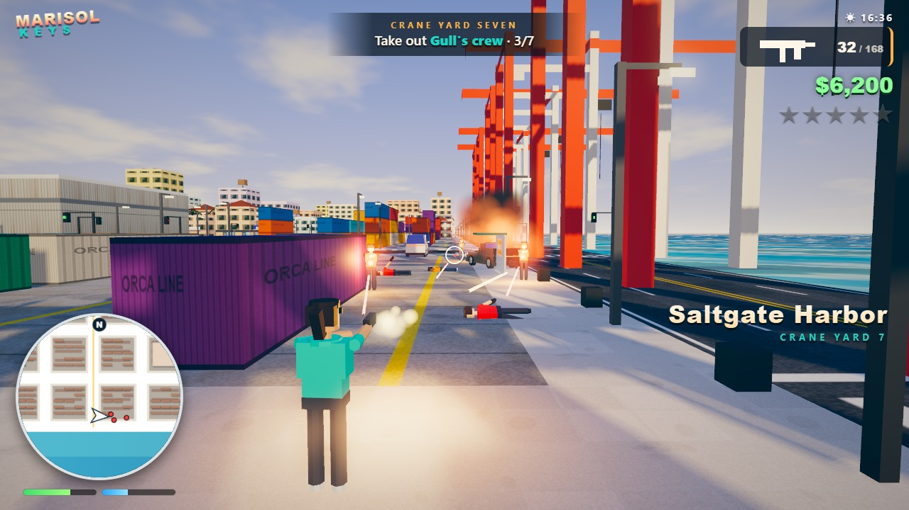
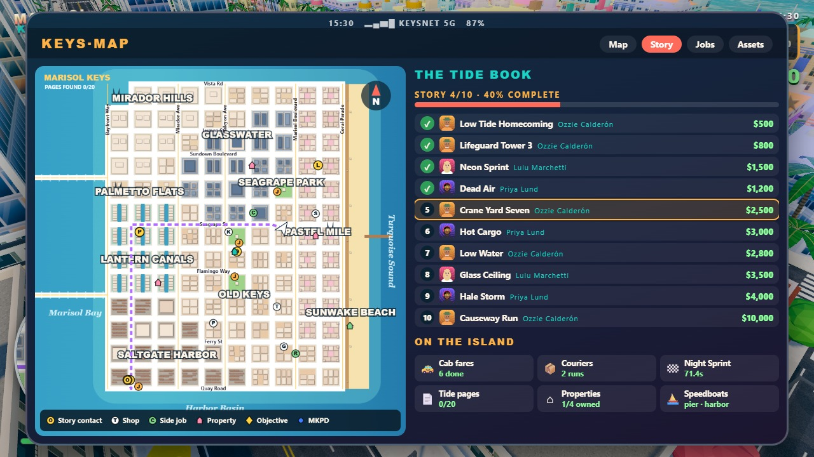

[](https://make.fun/c/gta6-01)
[](https://make.fun/c/gta6-01)
[](https://make.fun/c/gta6-01)

# Marisol Keys

*A sun-bleached open-world crime story that runs in your browser.*

Six years after she left on the last ferry, ex-ferry pilot **Tessa Vane** comes home to
**Marisol Keys** — a pastel island city of art-deco boulevards, glass towers, canals and a
container harbor, tied to the mainland by two long causeways. Her late brother left her a
waterproof ledger, *the Tide Book*, listing every payoff in the harbor. A crane-yard boss wants it.
A police captain wants it at the bottom of the bay. Tessa wants the whole island to read it.

Everything — the city, cars, people, signage, portraits, music and sound — is generated by the
game's own code in the browser. No asset files, no network requests.



| | |
|---|---|
|  |  |
|  | |

## Run it

```
node serve.ts          # serves game/ on http://localhost:8080
```

Open the page in desktop Chrome, click **New Game**, then click the view to capture the mouse.
Any static file server works too: the game is just the files under `game/`.

## Controls

| Key | On foot | In a vehicle |
|---|---|---|
| W A S D | walk | throttle, brake / reverse, steer |
| Shift | sprint | — |
| Space | jump | handbrake (drift) |
| Mouse | look / aim | look around |
| Left click / Right click | fire / aim | drive-by (hold right, click left) |
| F | steal / enter a car | get out |
| 1-4, wheel | fists, Marlin .38, Wasp SMG, Breaker 12 | — |
| R | reload | — |
| E | buy / start a job | start Keys Cab fares (in a taxi) |
| Q | buy armour at Keys Tactical | next radio station |
| H | — | horn |
| C | — | look behind |
| V | camera distance | camera distance, hood cam |
| G | — | siren (in an MKPD cruiser) |
| M or Tab | phone: map, story, jobs, assets | same |
| Esc or P | pause menu (save, settings, controls) | same |

## What's in it

- **The island** — 16 x 16 blocks in nine districts: Glasswater downtown towers, the Pastel Mile
  art-deco strip, Sunwake Beach with its boardwalk, lifeguard towers and pier, Lantern Canals with
  footbridges and moored skiffs, Saltgate Harbor with gantry cranes and container stacks, Mirador
  Hills villas with pools, Palmetto Flats, Old Keys and Seagrape Park; Pelican and Tarpon
  causeways to the mainland.
- **Landmarks** — the 206 m Lumen Tower with its crown of light rings, rounded art-deco corner
  towers with neon, Ozzie's Bait & Tackle, The Coral Room, the Sunwake pier café, a skyline of
  invented brands (Mango Bay Cola, Palmetto Bank, Vela Cinema, Hotel Esmeralda...).
- **Driving** — nine invented vehicles (Solara Vela sedan, Kestrel Strata GT, Mako Tradesman
  pickup, Keys Cab, Coastline Transit bus, MKPD Interceptor, Sunrise Courier van, Zephyr 400
  motorbike, Riptide 22 speedboat), arcade physics with handbrake drifts, crashes, damage smoke,
  fire and explosions, a speed-sensitive chase camera. Speedboats sail the bay and the open sea.
- **A living city** — lane-following traffic that stops at working traffic lights, pedestrians on
  the sidewalks, boardwalk and beach (sunbathers included) who flee from gunfire and speeding
  cars, boats on the water, and random street events: police pursuits, street racers, muggings
  you can break up for a reward.
- **Wanted level** — one to five stars from crimes the city sees; MKPD cruisers that route
  through the streets and ram, officers who bail out and shoot, roadblocks from three stars, the
  helicopter from four; break line of sight and leave the search circle to escape. Busted and
  wasted both have consequences.
- **Combat** — fists, pistol, SMG and shotgun with muzzle flash, tracers, sparks and blood;
  armed gang crews and officers that advance, strafe and return fire.
- **Story** — *The Tide Book*, nine missions with dialogue and painted portraits for Tessa, Ozzie
  Calderón, Priya Lund, Lulu Marchetti, Gideon "Gull" Moreau and Captain Rourke Hale: drives,
  races, wiretap relays against the clock, harbor shoot-outs, a stolen evidence van, a downtown takedown and a
  four-star run across the causeway. Contacts wait in person at their spots and face-to-face
  scenes cut to a two-shot camera; a new game opens with a letterboxed glide down from the skyline; MKPD dispatch chatter narrates every pursuit.
- **Side jobs and progression** — Keys Cab fares, Sunrise Couriers deliveries, the Night Sprint
  time trial, Vigilante runs in a stolen MKPD cruiser, Keys Tactical gun shop and body armour, Pastel Paint & Body resprays that shake the
  police, Sunwake Threads (five outfits for Tessa), four stunt-jump ramps that pay for airtime, Sunbelt Garage repairs and three tiers each of engine, tyre and armour tuning, police
  bribe stars that knock a star off, a phone map you can click to drop a GPS waypoint, four properties that pay out every game day, twenty hidden
  Tide Book pages, respawning health / armour / ammo / cash pickups, and a safehouse that saves
  and sleeps to the next morning.
- **HUD and menus** — rotating minimap drawn from the city plan with a GPS route, search circle
  and blips; health, armour, money, stars, weapon and ammo, objective and timer, speedometer,
  district pop-ups; a phone with the illustrated island map, story list, jobs and assets; title
  screen over a live flyover; pause, settings, controls; save and continue via localStorage.
- **Look and sound** — golden-hour sky shader with clouds, sky-lit reflections, soft shadows,
  ACES tone mapping, animated sea with sun glints and surf, a day/night cycle with street lamps,
  lit windows and glowing signs, tropical weather (passing cloud, storms with rain, wet reflective
  streets, lightning and thunder); WebAudio engine notes, tyre squeal, sirens, gunshots and three radio stations
  (Tidal 101.3, Static 88 FM, Reef Room Radio) composing their own music.

## Source layout

`game/src/` is split by job: `world/` (city plan, terrain, collision), `roads/`, `buildings/`,
`vegetation/`, `props/`, `water/`, `sky/`, `vehicles/`, `traffic/`, `peds/`, `player/`, `camera/`,
`combat/`, `fx/`, `police/`, `missions/`, `story/`, `activities/`, `economy/`, `ui/`, `audio/`,
`save/`, `core/` and `shots/`. three.js is the only library (`game/vendor/three.module.min.js`).

## Screenshots

`index.html?shot=<cover|boardwalk|harbor|map>&seed=1` builds a scripted scene with the real game
code and renders one stable frame. `tools/capture-shots.sh` takes all of them with headless Chrome over the DevTools protocol
(with `node serve.ts --port 8137` running).

## Hand-in

`main.ts` copies `game/` and `screenshots/` to the output folder and writes `dossier.json`:

```
mkdir -p out && MAKEFUN_OUTPUT_DIR=out node main.ts
```

MIT licensed. All names, places, characters and brands in the game are invented.
